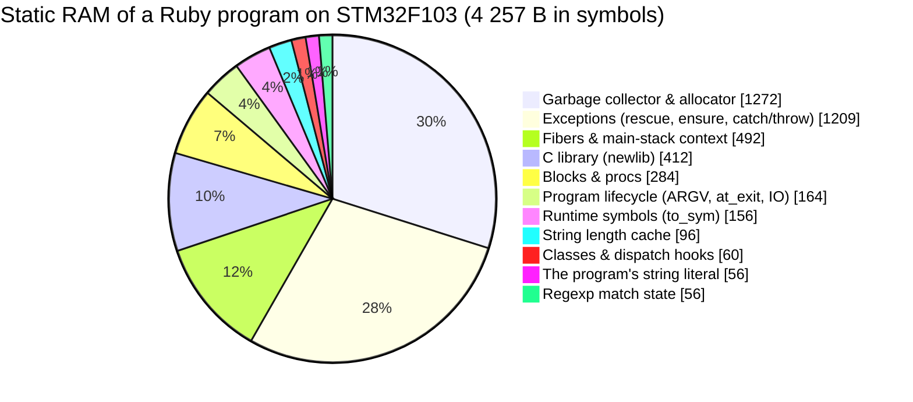
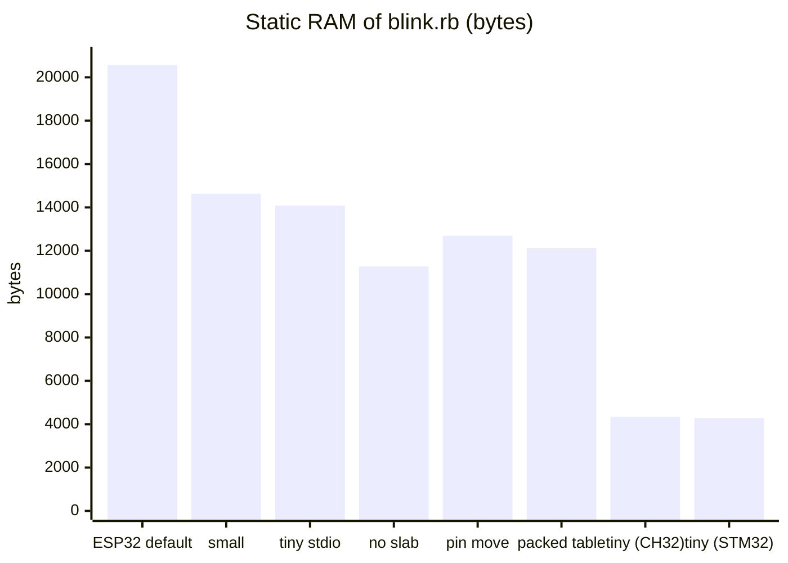

# Where 4 KB of SRAM goes: Ruby on a 20 KB microcontroller

spinel compiles Ruby ahead of time to C. On a 20 KB-SRAM part (STM32F103C8
"blue pill", CH32V203C8) a Ruby program now needs **4.2 KB of static RAM**
for the whole runtime: garbage collector, exceptions, blocks, fibers,
symbols, regexp state and the C library. That leaves about 16 KB for the GC
heap and the stack.

All numbers below are measured, not estimated. The program is
`app/stm32/blink.rb`, the one running on the blue pill: it raises and
rescues an exception, uses blocks, and reads a String. It is built with the
`tiny` preset (spinel branch `mcu-trim`), `-Os`, Cortex-M3, newlib-nano,
and linked behind the board's USB bootloader. Symbol sizes come from
`arm-none-eabi-nm`; the owning object comes from the linker map.

## 1. The 20 KB, as the chip sees it

```
 0x2000_5000 ┌──────────────────────────────┐  ← top of SRAM, initial SP
             │ stack  (grows down)          │    blink.rb peak:    716 B
             │   ▼                          │    exc.rb peak:    5 616 B
             │                              │
             │                              │
             │       free: shared by        │
             │       stack and heap         │    ~12.7 KB unused
             │       (16 196 B in all)      │    while blink.rb runs
             │                              │
             │   ▲                          │
             │ GC heap  (grows up, malloc)  │    blink.rb peak:  2 736 B
 0x2000_10BC ├──────────────────────────────┤  ← end of static RAM
             │ .bss   3 660 B  zeroed       │
 0x2000_0270 ├──────────────────────────────┤
             │ .data    620 B  from flash   │
 0x2000_0000 └──────────────────────────────┘
               static RAM total 4 284 B (4 280 B of sections + 4 B alignment)
```

The heap's peak doesn't grow with run time: 3 rounds and 30 rounds of the
blink loop both peak at 2 736 B. The collector runs after 2 KB of
allocation and its trigger never floats above 4 KB (`SP_GC_THRESHOLD_KB`,
`SP_GC_THRESHOLD_CAP_KB`), so garbage cannot pile up.

Heap and stack peaks were measured by running the same program (LED calls
stubbed) in qemu-riscv32 with a painted stack and an instrumented `sbrk`.
That target is also 32-bit, built with the same preset and runtime.

| program | what it does | heap peak | stack peak |
|---|---|---:|---:|
| `app/stm32/blink.rb` | the blue-pill blink: a rescued exception, blocks, a String | 2 736 | 716 |
| `app/qemu/inspect.rb` | Array/Hash `inspect` | 3 668 | 828 |
| `app/qemu/exc.rb` | 9 rescue scenarios, nested rescue 6 deep, retry, catch/throw | 6 732 | 5 616 |
| `app/qemu/procs.rb` | 3- to 40-argument calls, a 20-parameter lambda, splats | 9 640 | 2 144 |

## 2. The 4 280 bytes, by Ruby feature



```
 Garbage collector & allocator   1 272 B  ██████████████████████████████
 Exceptions                      1 209 B  ████████████████████████████▌
 Fibers & main-stack context       492 B  ███████████▌
 C library (newlib)                412 B  █████████▋
 Blocks & procs                    284 B  ██████▋
 Program lifecycle                 164 B  ███▉
 Runtime symbols                   156 B  ███▋
 String length cache                96 B  ██▎
 Classes & dispatch hooks           60 B  █▍
 The program's literal              56 B  █▎
 Regexp match state                 56 B  █▎
                                 ───────
                                 4 257 B in 251 symbols (+23 B alignment = 4 280 B)
```

The runtime's fixed infrastructure is 4.1 KB. The program itself owns one
56-byte frozen String literal plus its share of the proc and symbol tables.
A bigger program adds code (flash), not static RAM. Its objects live in the
heap.

### 2.1 Garbage collector & allocator: 1 272 B

```
 sp_gc_roots        512  ████████████████  shadow root stack, 128 entries
 sp_gc_remembered   128  ████              generational write barrier, 32 entries
 sp_gc_pinned       128  ████              pinned objects (C extensions, FFI), 32 entries
 123 state words    504  ███████████████▊  heap lists, byte counters, thresholds, hooks
```

- **Root stack (`SP_GC_STACK_MAX=128`).** spinel's collector is precise: a
  function pushes the address of each local that holds an object, and the
  collector marks from that list rather than scanning the C stack. Past 128
  live roots the list spills to a heap extension, so this is a speed knob,
  not a limit (`app/qemu/gc.rb` recurses 60 deep through it).
- **Remembered set and pinned list (32 each).** The generational
  collector's old-to-young pointers, and objects that must not move or die
  while C holds them. On overflow they fall back to a full mark.
- **State words.** Object and string heap heads, live-byte counters, the
  collection triggers, the retune hooks the program installs at start-up.
  These are single words in many places, and they add up.

### 2.2 Exceptions: 1 209 B

```
 sp_exc_stack       320  ████████████  8 frames × 40 B saved registers (setjmp)
 sp_exc_parent_id   192  ███████▏      builtin class hierarchy, 96 × 2 B
 sp_catch_stack     160  ██████        4 catch frames × 40 B
 per-frame slots    224  ████████▍     8 × 4 B each: class, message, object, state, 3 marks
 catch values        96  ███▋          4 × 16 B value + marks
 pending raise       48  █▊            the exception in flight (value, receiver, key)
 backtrace buffer    16  ▋             4 frames (no backtrace() on bare metal)
 39 small words     153  █████▋
```

- **Frames (`SP_EXC_STACK_MAX=8`).** Each `begin`/`rescue`/`ensure` that is
  active saves the registers it returns to. Upstream that is newlib's
  `jmp_buf`, 160 B on ARM (304 B on RISC-V), because it reserves room for
  FPU registers. The board layer's own `setjmp` saves the 10 registers a
  Cortex-M3 actually has: 40 B (`baremetal/setjmp_armv7m.S`).
- **Class hierarchy (192 B).** `rescue StandardError` must catch a
  `ZeroDivisionError`. Builtin classes have ids -100…-180, and this table
  maps each id to its parent's. Upstream indexed it from id 0, so the
  first 100 entries were wasted (fixed upstream in matz/spinel#11858).

### 2.3 Fibers & the main-stack context: 492 B

```
 sp_fiber_root_box  320  ████████████  the root Fiber (312 B struct, 2 × 72 B contexts)
 sp_main_stack_ctx   72  ██▋           main program's saved context
 sp_main_stack_caller 72 ██▋
 7 words             28  █
```

The root Fiber always exists: it is the one `Fiber.current` returns before
any other is made. A context is the 10 callee-saved registers plus stack
bookkeeping (`shim/esp32/src/ucontext_armv7m.S`).

### 2.4 C library: 412 B

`__sf` (312 B) is newlib's three `FILE` structs for stdin, stdout and
stderr. The board's tiny stdio never reads them, but the runtime's
references to `stdout` and `stderr` still link them in. `_impure_data` (76 B) is newlib's reentrancy struct,
which holds `errno`. A minimal replacement reent is a possible 300-byte cut.

### 2.5 Blocks & procs: 284 B

`_sp_proc_poly_args` (256 B, 16 × 16 B) is the side channel through which
a block or proc call passes boxed arguments. A boxed value (`sp_RbVal`) is
16 B on a 32-bit chip: a tag, a class id, and an 8-byte payload, so Integer
and Float fit unboxed. Calls with more than 16 arguments move to a heap
store (`--proc-arg-slots=16`; upstream's 64 slots took 1 KB).

### 2.6 Smaller items: 588 B

| item | bytes | what it is |
|---|---:|---|
| Program lifecycle | 164 | `sp_fd_retired` (64 B: one list, padded to a 64-byte cache line for threads, 52 B of padding on a single core), the `at_exit` table (32 B), ARGV/ARGF, signal flags |
| Runtime symbols | 156 | the first block of the pool for symbols made at run time (`"x".to_sym`, 16 × 4 B) and its hash index (8 slots); both move to the heap when outgrown |
| String length cache | 96 | 8 entries of String → character count, so `str.length` on UTF-8 is not a rescan every time (upstream: 128 entries, 1.5 KB) |
| Classes & dispatch | 60 | hooks the program installs (class names, `is_a?`, instance-variable table) |
| The program's literal | 56 | `"hello from ruby on a blue pill"` (30 B) with its String header, in `.data` |
| Regexp | 56 | `$~` capture slots and last-match pointers |

## 3. The diet: 869 KB to 4.3 KB

Each step is measured on the CH32 blink (`app/ch32/blink.rb`) on rv32 bare
metal. The last row is the blue-pill blink on the STM32F103 (Cortex-M3).

```
 upstream defaults (host-sized)     889 616 B  ██████████████████████████████████████████████████████▶ ×43 the chip's SRAM
 ESP32 "default" preset              20 568 B  ██████████████████████████████████████████████████▉
 "small" preset, -Os, no env,        14 632 B  ████████████████████████████████████▏
   no GC clock
 tiny stdio (no newlib FILE I/O)     14 080 B  ██████████████████████████████████▊
 SP_NO_SLAB (no slab allocator)      11 276 B  ███████████████████████████▉
 upstream pin move (+1.4 KB)         12 692 B  ███████████████████████████████▍
 packed class table (#11858)         12 116 B  █████████████████████████████▉
 "tiny" preset, 56-B jmp_buf,         4 336 B  ██████████▋
   constructors kept (CH32V203)
 same on STM32F103 (40-B jmp_buf)     4 280 B  ██████████▌
                                               └ one █ = 400 B
```



Upstream's defaults are sized for servers: a 65 536-entry root stack
(256 KB), a 65 536-entry remembered set (256 KB), and an 8 192-entry symbol
pool (64 KB). Those are the right sizes on a host and 40 times the whole
chip here.

### What the `tiny` preset turned off or shrank (CH32V203, rv32)

| change | where | saved |
|---|---|---:|
| `jmp_buf` 304 → 56 B (8 exception frames) | board `setjmp.h` | 1 984 |
| GC root stack 512 → 128 entries | existing knob | 1 536 |
| String#length cache 128 → 8 entries | `mcu-trim` knob | 1 440 |
| backtrace frames 256 → 4 | `mcu-trim` knob | 1 008 |
| proc side channel 64 → 16 slots | `mcu-trim` compiler switch | 768 |
| runtime symbol pool and index | existing knob + `mcu-trim` | 640 |
| `Signal.trap` table 65 → 1 (EXIT only) | `mcu-trim` knob | 520 |
| exception class-name cache off | `mcu-trim` knob | 384 |
| class lookup by name: scan, not hash | `mcu-trim` knob | 256 |
| **total** | | **8 536** |

Every default is unchanged: a host or ESP32 build is byte-for-byte what it
was. Only `presets/tiny.defs` turns these on.

## 4. What it costs in behaviour

- `Signal.trap` of anything but `EXIT` raises `ArgumentError` (no signals on
  the chip anyway).
- `--debug` backtraces are empty (there is no `backtrace()` on bare metal
  anyway).
- Calls with more than 16 boxed arguments, more than 128 live roots, or more
  than 16 run-time symbols spill to the heap. They are slower but still
  correct.
- The host GC torture corpus passes with every `tiny` knob (1 005 runs). The
  only failures are the tests that trap a non-EXIT signal.

## 5. Headroom and next cuts

- **The heap is the limit now, not static RAM.** An empty Hash allocates
  16 slots in 5 tables, about 800 B before its first key, so 20 small
  hashes fill a 16 KB heap. Starting containers at 4 slots is the next
  lever.
- **Static RAM that's left.** newlib's FILE structs and reent (~300 B with a
  minimal replacement); the fd list's cache-line padding (52 B); the root
  fiber's unused fields. The remaining ~3.5 KB is real state.
- **Flash is the other wall.** This blink is 43.8 KB of the 56 KB the
  bootloader leaves. One `String#split` adds ~90 KB (it pulls float
  formatting and bignum code), so that's the next flash lever.

## Reproduce

```
# static RAM by symbol (STM32 image)
arm-none-eabi-nm -S --size-sort build/ch32/blink.elf | grep -iE ' [bdsgc] '
# build and flash: docs/stm32f103.md
# heap/stack peaks: tools/ch32-qemu.sh (RISC-V), board with a painted stack
```
